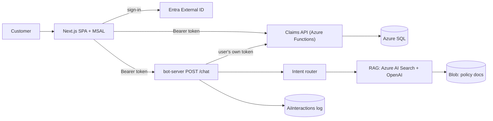

# Insurance Claims Assistant

A secure customer portal for insurance claims with an AI assistant. Customers sign in, see **only their own claims** (Auto, Home, Health, Travel and Life) with status, required documents and next step, and chat with an assistant that:

- answers **policy questions** (coverage, exclusions, deadlines, appeals, required documents) from company documents, with cited sources;
- reports on **their own claims** ("What is the status of CLM-001?", "Show my approved claims");
- refuses everything else safely (other customers' data, prompt injection, write actions, off-topic requests).

A claim moves through `Submitted → In Review → Action Required → Approved / Rejected`. The key design rule is that **authorization never depends on the AI**: the language model never sees a database, and every claim lookup is checked for ownership by the Claims API using the signed-in user's token.

**Where it can be used as a service.** The pattern fits any domain that has per-customer records behind an API plus a body of policy or help documents: banking (loan applications + product terms), healthcare administration (bills, appointments + coverage rules), HR (leave requests + handbook), telecom (tickets + FAQs), e-commerce (orders and returns + return policy), utilities, government permits, education admissions. To adapt it, replace the documents and re-run ingestion, swap the claims table/API for your entity, and adjust the router vocabulary. Because the backend is two stateless HTTP APIs secured with standard OAuth 2 bearer tokens, any client (web app, mobile app, another backend, a chat-platform bridge) can use it once it is registered in the identity tenant and its origin is added to the CORS allow-list.

## How it works



**Request flow.** The SPA signs the user in and attaches an access token to every call → `/chat` validates the token, applies rate limits, sanitizes and validates the message → the **intent router** picks a path → *policy* questions run RAG over the policy documents, *claim* questions call the Claims API with the user's token (ownership enforced there) → the reply is built, returned, and logged.

**Identity (delegated auth).** Identity verification, multi-factor authentication, password reset and passkey support are offloaded entirely to an external tenant (Microsoft Entra External ID); the application never handles or stores passwords or sessions. The SPA uses MSAL's redirect flow and requests the `Claims.Read` scope. Both APIs validate the JWT themselves (signature via the tenant's JWKS, issuer, audience, expiry, RS256 only, required scope). The user's identity is the token's `oid` claim, mapped to an internal `user_id` in the database.

**Frontend.** A React single-page app (Next.js App Router, React 19, MSAL React, Tailwind): paginated claims table (3/5/10 per page; API maximum 50) with a status filter, a claim detail page, and a floating chat widget showing answers with their sources. Errors, loading and empty states are handled explicitly.

**Claims API (Azure Functions, TypeScript).** `GET /api/claims` (pagination, status filter, stable newest-first ordering) and `GET /api/claims/{claimId}`. Queries are parameterized, filtered by the caller's `user_id`, and a claim lookup uses **both** claim ID and user ID. A claim that belongs to someone else and a claim that does not exist return the identical `403 Access denied`, so claim IDs cannot be enumerated.

**Intent routing.** Every message becomes `POLICY_QUERY`, `CLAIM_QUERY` or `UNSUPPORTED`. Deterministic rules run first (free, instant, testable), in this order: greeting → prompt-injection patterns → requests for other users' or bulk data ("all claims", "John's claim", "user 2") → write actions ("cancel my claim") → claim IDs (extracted by regex, never by the LLM) → personal claim phrasing → policy vocabulary. Only messages the rules cannot settle go to an LLM classifier whose JSON output is validated strictly; a low-confidence verdict becomes a clarifying question rather than a guess, and if the classifier is down the message defaults to policy RAG, which only reads public documents. Rules always override the LLM for dangerous patterns.

**Retrieval-augmented answers (RAG).** Eight policy documents are stored in Blob Storage, chunked by Markdown heading (about 400 tokens, 60 overlap, heading path embedded with each chunk), embedded with `text-embedding-3-small`, and indexed in Azure AI Search. Queries use **hybrid retrieval** (BM25 keyword + vector kNN, top 5). A **relevance gate** then computes cosine similarity between the question and each chunk (threshold 0.35, calibrated with `npm run rag:eval`); if nothing passes, the LLM is never called. Generation (`gpt-4o-mini`, temperature 0.1) is restricted to numbered context passages, must answer `INSUFFICIENT_CONTEXT` when the context does not cover the question, and treats context and question as data (prompt-injection hygiene). Citations are produced by our code from retrieval metadata for the passages the model actually cited, never by model-written text. Claim answers use fixed templates instead of LLM formatting, so claim data cannot be hallucinated.

**Fallbacks.** A single configurable message is returned for: no search results, low relevance, model-declared insufficient context. Dedicated messages cover greetings, injection, other users' data, write actions and clarification; upstream failures get friendly messages (no internals).

**Response JSON** (`POST /chat`):

```json
{
  "conversationId": "5c1b0f0e-6a63-4d0e-9a35-1f4a1f0c2b11",
  "intent": "POLICY_QUERY",
  "answer": "You have 30 days from the date of the decision letter to file an appeal.",
  "sources": [{ "documentTitle": "Appeals", "section": "When you can appeal" }],
  "fallback": false
}
```

**Observability and privacy.** Each chat writes one row to `AiInteractions` *after* the reply is sent (8 s cap; failures are dropped with a warning and never affect the user). Logged: conversation id, user id (resolved from the token's `oid` inside the INSERT), query (max 2,000 chars), intent, retrieval trace (source, chunk id, similarity score; no document text), model, prompt/completion tokens, total/retrieval/generation latency, response, status (`success`/`fallback`/`error`) and `error_type` (error class, RAG fallback reason, or the routing reason for refusals, which makes security refusals queryable). **Not logged:** access tokens or secrets, and the text of answers to claim questions, which is replaced by `[claim details not logged]` because it contains personal claim data. Claim records live only in Azure SQL, are served only through the Claims API, and are never sent to the model or stored in the index. Analytics queries are in `database/observability-queries.sql`.

**Abuse protection.** Sliding-window rate limits on `/chat`: per IP (120/min, applied before token validation), per user (15/min) and a per-user daily cap (200, which also caps model spend); 429 with `Retry-After`. Messages are sanitized before routing (Unicode NFKC normalization, removal of zero-width/bidi/control characters, whitespace collapse) and validated (1-1000 characters, 8 KB body, JSON only). Timeouts and retries bound every upstream call (OpenAI 20 s with 2 retries, classifier 8 s, Claims API 30 s, whole chat request 45 s → 504), and the database client retries transient errors with backoff for a paused serverless database.

**What replaced or was left out of the original design.**

| Original idea | What is used instead |
|---|---|
| Bot Framework + Web Chat + Direct Line | A plain authenticated `POST /chat` endpoint and a custom React chat widget (fewer moving parts; the Bot Framework SDK is being retired) |
| Azure OpenAI | OpenAI API (`gpt-4o-mini`, `text-embedding-3-small`) |
| Azure AI Search integrated vectorization | A deterministic ingestion script (chunk → embed → upload → prune stale chunks) |
| Thresholding on search score | Cosine-similarity gate (hybrid scores are rank-based and not comparable across queries) |
| LLM-generated claim answers | Fixed templates over data fetched through the API |
| Custom login and sessions | Delegated authentication in the external tenant |

## Security model

| Threat | Control |
|---|---|
| Reading another customer's claim | Identity comes only from the validated token; ownership enforced in the Claims API (`WHERE claim_id AND user_id`); uniform 403; the bot forwards the user's own token and never uses a privileged one |
| Spoofed identity (`?userId=2`, forged body fields) | Client-supplied identity is ignored; the SQL `user_id` is derived from the token's `oid` |
| SQL injection | Parameterized queries; `status` is a strict enum; claim IDs must match `^CLM-\d{3,6}$`; invalid input is rejected with 400 before any SQL runs |
| Prompt injection / obfuscated injection | Router pattern rules after sanitizing; grounded prompt treating input as data; LLM has no tool or database access |
| Abuse and cost | Per-IP, per-user and daily limits; message and body size limits; timeouts |
| Data leakage in errors | Uniform error bodies; details only in server logs; request IDs for correlation |
| XSS / clickjacking / sniffing | Chat text rendered without HTML injection; Content-Security-Policy on the frontend (production), `default-src 'none'` on the API, `X-Frame-Options: DENY`, `nosniff`, `Referrer-Policy`, `Permissions-Policy`, HSTS over HTTPS |
| Secrets exposure | Configuration via environment variables only; the frontend receives just the public client ID, authority and scope; `.env` and `local.settings.json` are git-ignored |

**CORS.** Browsers block cross-origin calls unless the server opts in, and here the SPA, the Claims API and the bot-server live on three different origins. The bot-server uses an exact-origin allow-list (`ALLOWED_ORIGIN`), the Function App's CORS setting must list the SPA origin, and the SPA's redirect URI must be registered on the Entra app. Calls authenticate with an `Authorization` header rather than cookies, so there is no ambient credential to forge (CSRF does not apply). CORS only governs browsers: both APIs validate tokens on every request regardless of origin.

## Running it

1. **Azure resources:** Azure SQL database (free serverless offer works), Storage account, AI Search service, and an Entra External ID tenant with two app registrations: an API (expose scope `Claims.Read`, access token version 2) and an SPA (redirect `http://localhost:3000`, permission to the API scope). Create a sign-up/sign-in user flow.
2. **Database:** run `database/schema.sql`, then `database/seed.sql` (200 customers, ~600 claims; users 1 and 2 get one claim in every status). Link a test login: `UPDATE dbo.Users SET entra_object_id = '<object id>' WHERE user_id = 1;`. Allow your client IP in the SQL firewall.
3. **Configuration:** copy `.env.example` to `bot-server/.env`, `azure-function/local.settings.example.json` to `local.settings.json`, and `frontend/.env.local.example` to `.env.local`; fill in tenant, client IDs, SQL, OpenAI and Search values.
4. **Index the policies:** `npm run ingest` in `bot-server/` (use `ingest:recreate` after changing the index schema, `ingest:dry` to preview chunks).
5. **Run:** `npm start` in `azure-function/`, `npm run dev` in `bot-server/`, `npm run dev` in `frontend/`, then open `http://localhost:3000`.

For deployment: set `TRUST_PROXY=1` behind Azure App Service, configure CORS on both APIs, register the production redirect URI on the SPA, and use a Search *query* key at runtime.

## Scripts and tests

All tests are hermetic: they need no network, cloud account or API key.

| File | Purpose |
|---|---|
| `database/schema.sql`, `seed.sql` | Tables, constraints, indexes; deterministic seed data |
| `database/observability-queries.sql` | Analytics: outcomes by intent, fallback reasons, latency and tokens per day, most-retrieved chunks |
| `bot-server/src/scripts/ingest.ts` | Blob → chunk → embed → Search index; idempotent; flags `--dry-run`, `--recreate` |
| `bot-server/src/scripts/ragEval.ts` | Calibration run: prints similarity scores and answers for on-topic and off-topic questions to tune `RAG_MIN_SCORE` |
| `bot-server/src/scripts/routerTest.ts` | Intent router: policy, own-claim, other-user, bulk-data, injection, write-action and greeting cases; claim-ID and status extraction; LLM classifier path with stubs (accepted, low-confidence, failing, and rules overriding a wrong verdict) |
| `bot-server/src/scripts/chatTest.ts` | Chat orchestrator and HTTP layer with stubbed dependencies: policy answers with sources, claim formatting, "Access denied", refusals, upstream-failure messages, expired-token handling; log-record building (claim-answer redaction, truncation, error types), non-blocking logging; request validation (401/400) |
| `bot-server/src/scripts/hardeningTest.ts` | Sliding-window limiter on a fake clock (allows N, blocks with a retry time, keys isolated, window expires); per-user, daily and per-IP limits (anonymous flooding gets 429 before auth); timeouts (504); security headers; sanitizing (zero-width and full-width characters; obfuscated injection caught only after sanitizing); body guardrails (non-string, array, oversized, wrong content type); CORS rejects foreign origins |
| `azure-function/src/tests/security.test.ts` | Claims API with fake SQL and token validation: owner access, cross-user 403 identical to not-found, both-predicate lookup, token-derived `user_id` despite spoofed query parameters, injection and bad-parameter rejection before SQL, no internals in error bodies |

Run `npm test` in `azure-function/` and in `bot-server/`. `docs/security-checklist.md` lists the manual end-to-end checks.

## Known limitations

- Chat is single-turn: each message is answered on its own, so follow-ups like "and the second one?" are not understood.
- Rate limits are in memory (per instance); several instances need a shared store such as Redis.
- Router rules are English-only; other languages fall through to the LLM classifier. Mixed questions ("why was CLM-004 rejected and how do I appeal?") are answered as claim questions only.
- The assistant is read-only: it cannot file, change or cancel anything. Rejection reasons are not stored, so it reports status and next step only.
- The CSP allows inline scripts and styles (a Next.js requirement without nonces).
- User queries are logged as typed and may contain personal text; production use needs a retention policy.
- The bot forwards the user's access token to the Claims API (simple and ownership-safe, but a dedicated on-behalf-of exchange would be stricter).
- The similarity threshold was calibrated on a small question set and the corpus is eight short documents; retune with `rag:eval` when documents change. Free-tier Azure services can be paused or reclaimed, and a paused serverless database delays the first request.
